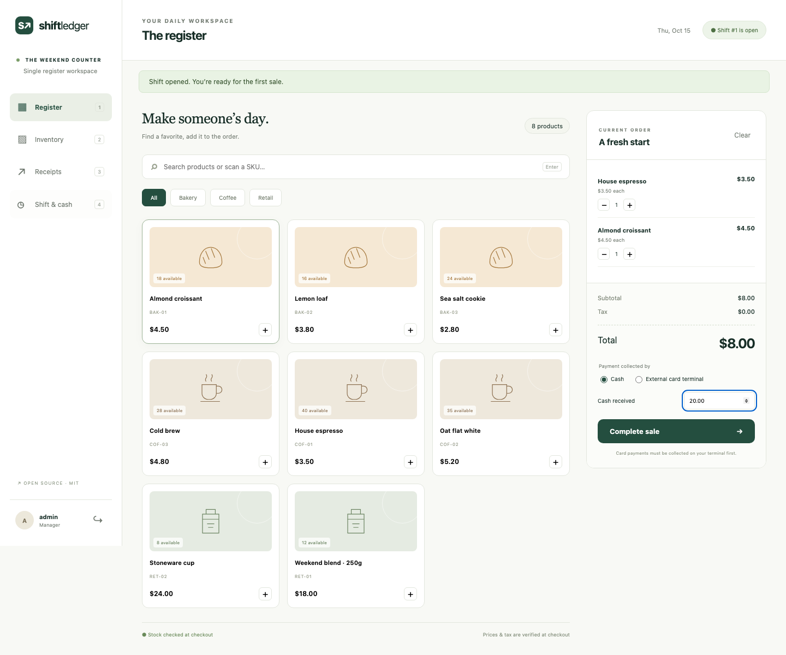
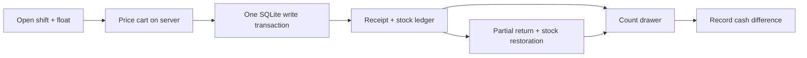
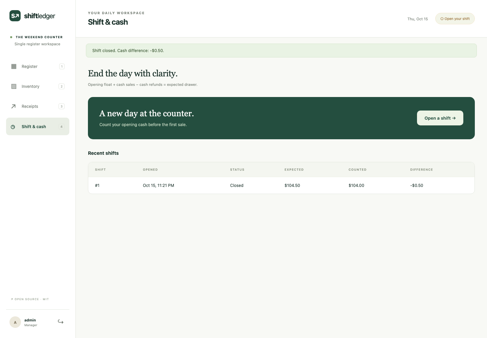

<div align="center">

# Shift Ledger POS

### Good days. Balanced drawers.

A self-hosted register for a small counter, café or pop-up.<br>
**Sell → return → reconcile. Every stock movement has a reason.**

[](https://github.com/XingCEO/shift-ledger-pos/actions/workflows/ci.yml)


[](LICENSE)

[Start locally](#start-in-two-minutes) · [How money moves](#how-money-moves) · [Tests](#tested-workflows) · [Operating guide](docs/OPERATIONS.md)



</div>

## A small register with a complete loop

Most demo POS apps stop at adding products to a cart. Shift Ledger carries the transaction through stock deduction, immutable receipt prices, partial returns and the cash count at closing time.

| At the counter | Behind the counter |
| --- | --- |
| Search by name or scan a SKU and press Enter | Create, edit and archive products |
| Cash or an already-collected external card payment | Record stock deliveries, waste and corrections |
| Tax calculated on the server in integer minor units | Manager and cashier access levels |
| Printable receipt and change due | Partial refunds using the original price and tax |
| Safe retry of an interrupted sale | Opening float, expected cash and recorded variance |
| Desktop and mobile layouts | CSV export of the complete sales ledger |

No cloud account, CDN, frontend build step or external payment service is required. The app works without internet while your browser can reach the local server.

## Start in two minutes

Requires Python 3.11+. Install dependencies once while online.

```bash
git clone https://github.com/XingCEO/shift-ledger-pos.git
cd shift-ledger-pos
python3 -m venv .venv
. .venv/bin/activate
python -m pip install .
python -m shift_ledger_pos --demo
```

Open **http://127.0.0.1:5055**. Sign in as `admin` using the randomly generated password printed in your terminal. `--demo` only seeds a **new database**; restarting does not reset stock, transactions or passwords.

1. Open a shift and enter the opening cash.
2. Add products, choose a payment method and complete the sale.
3. Open **Receipts** to print a receipt or record a partial return.
4. Open **Shift & cash**, count the drawer and close the shift.

The demo uses USD with two decimal places and zero tax on seeded products. Product tax rates are configurable in the inventory editor. This release assumes one two-decimal currency per database.

For an empty shop, set `POS_ADMIN_PASSWORD` to a unique password of at least 12 characters and omit `--demo`. Do not put real credentials in shell history or commit them. See [the operating guide](docs/OPERATIONS.md) for account creation and deployment.

## How money moves



- **Integer arithmetic:** prices use minor units; tax uses basis points. Tax rounds half up once per product line.
- **No overselling:** `BEGIN IMMEDIATE` serializes stock-changing transactions. A concurrent last-item sale can only succeed once.
- **Safe retries:** sale and refund request keys are unique. Repeating the same body returns the original result; reusing a key with different content is rejected.
- **Original receipt values:** catalog edits never rewrite old receipts. Partial refund amounts are allocated cumulatively so a full return equals the original line total exactly.
- **Cash accountability:** expected cash is opening float + cash sales − cash refunds processed during that shift. External card payments are excluded.
- **Recoverable browser retry:** a pending sale request is kept in that tab’s session storage and restored after reload. An unresolved request must be retried before changing the order. Closing the tab can discard this recovery record; review receipts before entering an uncertain sale again.



## Tested workflows

```bash
python -m unittest discover -v

# Browser tests (optional development dependencies)
npm ci
npx playwright install chromium
PYTHON=python npm run test:e2e
```

The Python suite covers transaction rollback, concurrent stock contention, duplicate requests, tax allocation, partial refunds, prior-shift returns, catalog edits, manager authorization, CSRF and CSV export. Browser tests exercise the actual UI from login through sale, return and close, plus mobile overflow and recovery from insufficient tender. They create a disposable database and synthetic credentials.

Screenshots in this README are produced by the committed browser tests, not design mockups. CI runs Python 3.11/3.13 and Chromium.

## Built to be changed

```text
shift_ledger_pos/
  db.py          schema, connections and transaction boundary
  service.py     stock, pricing, receipts, refunds and reconciliation
  __init__.py    HTTP routes, sessions, roles and CSRF
  static/        responsive CSS and dependency-free browser JavaScript
  templates/     workspace and printable receipt
```

The business service can be called directly from Python, making it useful for agent-driven extensions and integration tests. Start with [the API contract](docs/API.md) and the [transaction review Skill](skills/transaction-invariant-review/SKILL.md) before modifying money or inventory behavior.

## Deliberate boundaries

This is a working **experimental v0.1 for one location and one register**. It does not implement fiscal certification, Taiwan e-invoices, payment processing, card data handling, discounts, split tenders, cash payouts, multi-location stock, hardware printer protocols or accounting integrations. A card sale records a payment already collected elsewhere; the app never charges a card.

The built-in server is for local evaluation. Use a production WSGI server behind HTTPS for a network deployment, keep it private, back up SQLite correctly and review jurisdiction-specific receipt/tax obligations before real trading. Login throttling is process-local; run one application worker or add a shared limiter. This project has automated tests, not a claim of production certification.

## Contribute

Bring a concrete counter workflow and a failing regression test. Money/stock changes must preserve the invariants above and include a transaction-level test. UI changes should include a browser test when behavior changes. See [CONTRIBUTING.md](CONTRIBUTING.md).

[MIT](LICENSE) © 2026 XingCEO. Independent implementation using Flask and SQLite; no code copied from another POS product.
